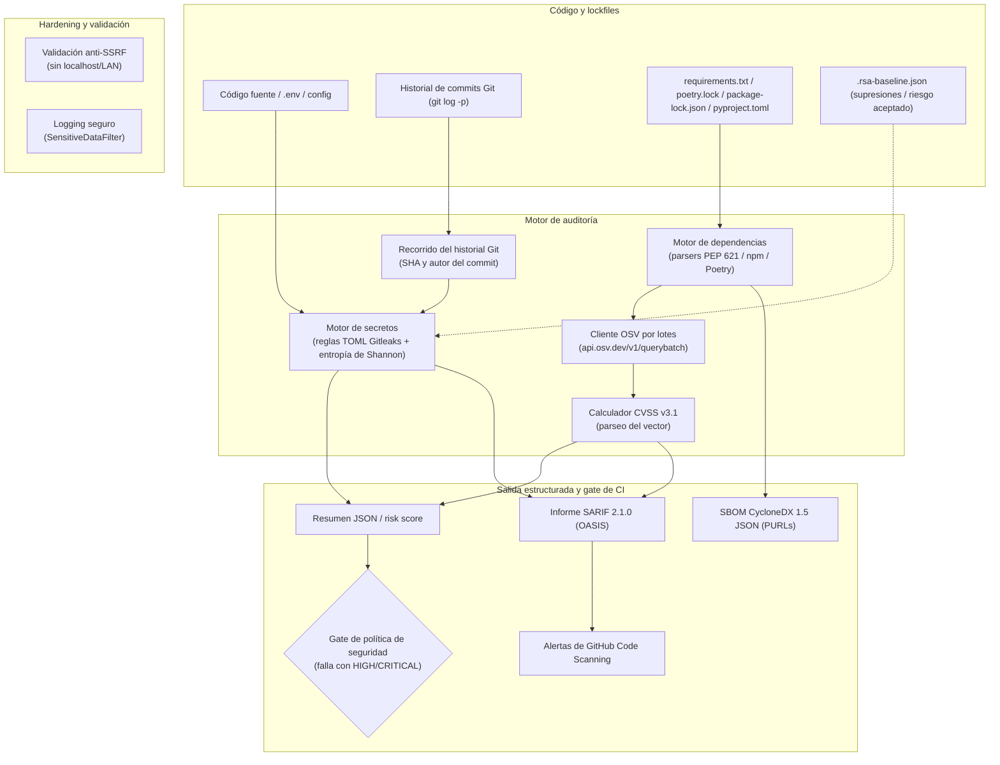

<h3 align="center">
  
  Repo Secret Auditor
  
  <br/>
  <a href="https://github.com/h3n-x/repo-secret-auditor">Escaneo de secretos y dependencias para CI/CD: reglas compatibles con Gitleaks, historial, OSV, SBOM y SARIF</a>
  <br/><br/>
  <p>
    🌐 <a href="README.md">English</a> · <strong>Español</strong>
  </p>
</h3>

<p align="center">
  
  
  
  
</p>

<p align="center">
  
  
  
</p>

<p align="center">
  <a href="#%EF%B8%8F-arquitectura">Arquitectura</a>
  ·
  <a href="#-inicio-rápido">Inicio rápido</a>
  ·
  <a href="#%EF%B8%8F-github-actions">GitHub Actions</a>
  ·
  <a href="LICENSE">Licencia</a>
</p>

&nbsp;

## 🪄 Acerca de

Un escáner estático de seguridad de código abierto para auditar repositorios en pipelines de CI/CD: detección de secretos de alta
fidelidad (reglas TOML compatibles con Gitleaks), escaneo de commits pasados (`--history`), análisis de vulnerabilidades en
dependencias con la API OSV Batch de Google, supresiones estructuradas con `.rsa-baseline.json`, SBOM en **CycloneDX 1.5 JSON**
y salida **SARIF 2.1.0** para las alertas nativas de **GitHub Code Scanning**.

> [!NOTE]
> Los secretos nunca se imprimen en texto plano, ni en los informes SARIF ni en los logs: cada hallazgo lleva un hash SHA-256 no
> reversible como identificador de evidencia.

&nbsp;

## ✨ Funcionalidades

### Secretos e historial

| | |
|---|---|
| 🕰️ **Escaneo profundo de commits** (`--history`) | Recorre todo el historial (`git log -p`) para detectar credenciales que se agregaron y después se "borraron", con el SHA, la fecha y el autor del commit. |
| 📜 **Motor de reglas TOML** | Carga y compila reglas compatibles con Gitleaks desde [`src/app/scanner/rules.toml`](src/app/scanner/rules.toml). |
| 🗝️ **Reglas curadas** | Claves privadas (RSA, OpenSSH, EC, PGP, DSA), claves de acceso y secretas de AWS, API keys de GCP, tokens de Slack, claves de Stripe, API keys de OpenAI/Anthropic, JWT y tokens Bearer, PATs de GitHub clásicos y fine-grained. |
| 📌 **Línea base** (`.rsa-baseline.json`) | Registra hallazgos conocidos o riesgo aceptado, con hash de evidencia y fecha de expiración opcional, para no romper el pipeline. |
| 🎲 **Filtro de entropía de Shannon** | Análisis de aleatoriedad por juego de caracteres para descartar tokens triviales. |
| 🧹 **Filtro de placeholders** | Ignora ejemplos de documentación (`EXAMPLE`, `PLACEHOLDER`, `YOUR_KEY`, `DUMMY`). |

### Dependencias y SBOM

| | |
|---|---|
| 📦 **Lockfiles modernos** | Python: `requirements.txt`, `pyproject.toml` (PEP 621) y `poetry.lock`. Node.js: `package-lock.json` (v1, v2 y v3 con árboles anidados). |
| 🧾 **SBOM CycloneDX 1.5** | Inventario formal de componentes con Package URLs estándar (`pkg:pypi/...`, `pkg:npm/...`). |
| ⚡ **Consultas por lotes a OSV** (`/v1/querybatch`) | Una sola petición HTTP resuelve todos los paquetes en paralelo en menos de 1,5 s. |
| 🧮 **Calculador CVSS v3.1** | Calcula el score base a partir del vector de OSV (p. ej. `CVSS:3.1/AV:N/AC:L/PR:N/UI:N/S:U/C:H/I:H/A:H` → `9.8 CRITICAL`), así nunca se degrada una severidad por accidente. |

### Hardening

| | |
|---|---|
| 🌐 **Mitigación estricta de SSRF** | Lista blanca de hosts Git públicos (`github.com`, `gitlab.com`, `bitbucket.org`, `gitea.io`); rechaza `localhost`, `127.0.0.1`, IPs de metadata cloud (`169.254.169.254`) y esquemas inseguros (`git://`, `http://`). |
| 🚫 **Prevención de inyección de argumentos Git** | `ref` se valida contra caracteres de opción (`-`). |
| 🔏 **Filtro de datos sensibles en logs** | `SensitiveDataFilter` en el `logging.Handler` censura el mensaje formateado y sus `*args`. |

&nbsp;

## 🏛️ Arquitectura



&nbsp;

## 🚀 Inicio rápido

**Requisitos:** Python 3.12+ (compatible con 3.13 y 3.14).

```bash
git clone https://github.com/h3n-x/repo-secret-auditor.git
cd repo-secret-auditor
python3 -m venv .venv && source .venv/bin/activate
pip install --upgrade pip
pip install -e ".[dev]"
```

Escanear un directorio, con SARIF, SBOM CycloneDX e historial de commits:

```bash
rsa --project-root . \
    --summary artifacts/summary.json \
    --sarif artifacts/findings.sarif \
    --sbom artifacts/bom.json \
    --history \
    --fail-on high
```

&nbsp;

## 🛡️ GitHub Actions

Llama al workflow reutilizable desde cualquier repositorio para escanear pull requests y publicar alertas en
**Security → Code scanning alerts**:

```yaml
name: Security Audit Pipeline

on:
  pull_request:
    branches: [main]
  push:
    branches: [main]

jobs:
  audit:
    uses: h3n-x/repo-secret-auditor/.github/workflows/reusable-security-scan.yml@main
    permissions:
      contents: read
      security-events: write
    with:
      fail-on-severity: true
      summary-json-path: artifacts/summary.json
      sarif-path: artifacts/findings.sarif
    secrets:
      github-token: ${{ secrets.GITHUB_TOKEN }}
```

&nbsp;

## 📊 Matriz de detección de secretos

| Tipo de secreto | Patrón / formato | Severidad | Entropía mín. |
|---|---|---|---|
| **AWS Secret Access Key** | 40 caracteres base64 (`[A-Za-z0-9/+=]{40}`) | Critical | 3.5 |
| **Claves privadas** | `-----BEGIN (RSA\|EC\|OPENSSH\|PGP) PRIVATE KEY-----` | Critical | 0.0 |
| **GitHub PAT** | `ghp_...`, `github_pat_...`, `ghu_...` | High | 3.3 |
| **GCP API Key** | `AIza[0-9A-Za-z\-_]{35}` | High | 3.2 |
| **Token de Slack** | `xoxb-...`, `xoxp-...`, `xoxa-...` | High | 2.8 |
| **API key de Stripe** | `sk_live_...`, `rk_live_...` | High | 3.0 |
| **API key de OpenAI** | `sk-...`, `sk-proj-...` | High | 3.5 |
| **JSON Web Token** | `ey...ey...` (3 segmentos base64url) | Medium | 3.5 |
| **API key genérica** | Tokens de alta entropía asignados a variables clave | Medium | 3.5 |

&nbsp;

## 🧪 Pruebas y calidad

```bash
pytest tests/ --cov=src --cov-fail-under=85   # suite completa con cobertura
ruff check .                                   # estilo y reglas estáticas
mypy src tests                                 # tipado estricto
pip-audit                                      # dependencias contra la base de CVEs
```

&nbsp;

<p align="center">
  
</p>

<p align="center">
  Copyright © 2026 <a href="https://github.com/h3n-x">h3n-x</a>
</p>

<p align="center">
  <a href="https://github.com/h3n-x/repo-secret-auditor/blob/main/LICENSE"></a>
</p>
