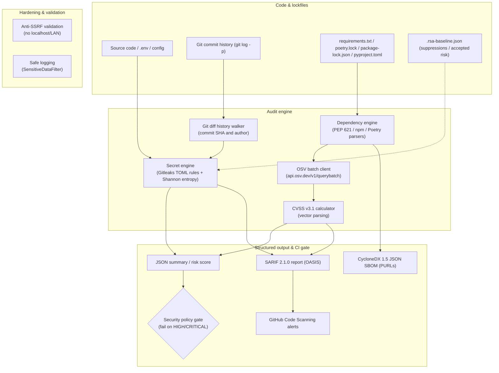

<h3 align="center">
  
  Repo Secret Auditor
  
  <br/>
  <a href="https://github.com/h3n-x/repo-secret-auditor">Secret and dependency scanning for CI/CD: Gitleaks-compatible rules, commit history, OSV, SBOM and SARIF</a>
  <br/><br/>
  <p>
    🌐 <strong>English</strong> · <a href="README.es.md">Español</a>
  </p>
</h3>

<p align="center">
  
  
  
  
</p>

<p align="center">
  
  
  
</p>

<p align="center">
  <a href="#%EF%B8%8F-architecture">Architecture</a>
  ·
  <a href="#-quick-start">Quick start</a>
  ·
  <a href="#%EF%B8%8F-github-actions">GitHub Actions</a>
  ·
  <a href="LICENSE">License</a>
</p>

&nbsp;

## 🪄 About

An open-source static security scanner built to audit repositories in CI/CD pipelines: high-fidelity secret detection
(Gitleaks-compatible TOML rules), scanning of past commits (`--history`), dependency vulnerability analysis through the Google
OSV Batch API, structured suppressions with `.rsa-baseline.json`, a **CycloneDX 1.5 JSON** SBOM and **SARIF 2.1.0** output for
native **GitHub Code Scanning** alerts.

> [!NOTE]
> Secrets are never printed in plain text, neither in SARIF reports nor in logs: each finding carries a non-reversible SHA-256
> hash as its evidence identifier.

&nbsp;

## ✨ Features

### Secrets and history

| | |
|---|---|
| 🕰️ **Deep commit scanning** (`--history`) | Walks the full history (`git log -p`) to catch credentials that were added and later "deleted", with the commit SHA, date and author. |
| 📜 **TOML rule engine** | Loads and compiles Gitleaks-compatible rules from [`src/app/scanner/rules.toml`](src/app/scanner/rules.toml). |
| 🗝️ **Curated rules** | Private keys (RSA, OpenSSH, EC, PGP, DSA), AWS access and secret keys, GCP API keys, Slack tokens, Stripe keys, OpenAI/Anthropic API keys, JWT and Bearer tokens, classic and fine-grained GitHub PATs. |
| 📌 **Baseline** (`.rsa-baseline.json`) | Records known findings or accepted risk, with an evidence hash and an optional expiry date, so the pipeline doesn't break. |
| 🎲 **Shannon entropy filter** | Per-charset randomness analysis to discard trivial tokens. |
| 🧹 **Placeholder filter** | Ignores documentation examples (`EXAMPLE`, `PLACEHOLDER`, `YOUR_KEY`, `DUMMY`). |

### Dependencies and SBOM

| | |
|---|---|
| 📦 **Modern lockfiles** | Python: `requirements.txt`, `pyproject.toml` (PEP 621) and `poetry.lock`. Node.js: `package-lock.json` (v1, v2 and v3 with nested trees). |
| 🧾 **CycloneDX 1.5 SBOM** | A formal component inventory with standard Package URLs (`pkg:pypi/...`, `pkg:npm/...`). |
| ⚡ **OSV batch queries** (`/v1/querybatch`) | One HTTP request resolves every package concurrently in under 1.5 s. |
| 🧮 **CVSS v3.1 calculator** | Computes the base score from the OSV vector (e.g. `CVSS:3.1/AV:N/AC:L/PR:N/UI:N/S:U/C:H/I:H/A:H` → `9.8 CRITICAL`), so severities are never downgraded by accident. |

### Hardening

| | |
|---|---|
| 🌐 **Strict SSRF mitigation** | Allowlist of public Git hosts (`github.com`, `gitlab.com`, `bitbucket.org`, `gitea.io`); rejects `localhost`, `127.0.0.1`, cloud metadata IPs (`169.254.169.254`) and insecure schemes (`git://`, `http://`). |
| 🚫 **Git argument injection prevention** | `ref` is validated against option characters (`-`). |
| 🔏 **Sensitive data log filter** | `SensitiveDataFilter` in the `logging.Handler` redacts the formatted message and its `*args`. |

&nbsp;

## 🏛️ Architecture



&nbsp;

## 🚀 Quick start

**Requirements:** Python 3.12+ (3.13 and 3.14 supported).

```bash
git clone https://github.com/h3n-x/repo-secret-auditor.git
cd repo-secret-auditor
python3 -m venv .venv && source .venv/bin/activate
pip install --upgrade pip
pip install -e ".[dev]"
```

Scan a directory, with SARIF, a CycloneDX SBOM and the commit history:

```bash
rsa --project-root . \
    --summary artifacts/summary.json \
    --sarif artifacts/findings.sarif \
    --sbom artifacts/bom.json \
    --history \
    --fail-on high
```

&nbsp;

## 🛡️ GitHub Actions

Call the reusable workflow from any repository to scan pull requests and publish alerts under
**Security → Code scanning alerts**:

```yaml
name: Security Audit Pipeline

on:
  pull_request:
    branches: [main]
  push:
    branches: [main]

jobs:
  audit:
    uses: h3n-x/repo-secret-auditor/.github/workflows/reusable-security-scan.yml@main
    permissions:
      contents: read
      security-events: write
    with:
      fail-on-severity: true
      summary-json-path: artifacts/summary.json
      sarif-path: artifacts/findings.sarif
    secrets:
      github-token: ${{ secrets.GITHUB_TOKEN }}
```

&nbsp;

## 📊 Secret detection matrix

| Secret type | Pattern / format | Severity | Min entropy |
|---|---|---|---|
| **AWS Secret Access Key** | 40 base64 characters (`[A-Za-z0-9/+=]{40}`) | Critical | 3.5 |
| **Private keys** | `-----BEGIN (RSA\|EC\|OPENSSH\|PGP) PRIVATE KEY-----` | Critical | 0.0 |
| **GitHub PAT** | `ghp_...`, `github_pat_...`, `ghu_...` | High | 3.3 |
| **GCP API Key** | `AIza[0-9A-Za-z\-_]{35}` | High | 3.2 |
| **Slack token** | `xoxb-...`, `xoxp-...`, `xoxa-...` | High | 2.8 |
| **Stripe API key** | `sk_live_...`, `rk_live_...` | High | 3.0 |
| **OpenAI API key** | `sk-...`, `sk-proj-...` | High | 3.5 |
| **JSON Web Token** | `ey...ey...` (3 base64url segments) | Medium | 3.5 |
| **Generic API key** | High-entropy tokens assigned to key variables | Medium | 3.5 |

&nbsp;

## 🧪 Testing and quality

```bash
pytest tests/ --cov=src --cov-fail-under=85   # full suite with coverage
ruff check .                                   # style and static rules
mypy src tests                                 # strict typing
pip-audit                                      # dependencies against the CVE database
```

&nbsp;

<p align="center">
  
</p>

<p align="center">
  Copyright © 2026 <a href="https://github.com/h3n-x">h3n-x</a>
</p>

<p align="center">
  <a href="https://github.com/h3n-x/repo-secret-auditor/blob/main/LICENSE"></a>
</p>
